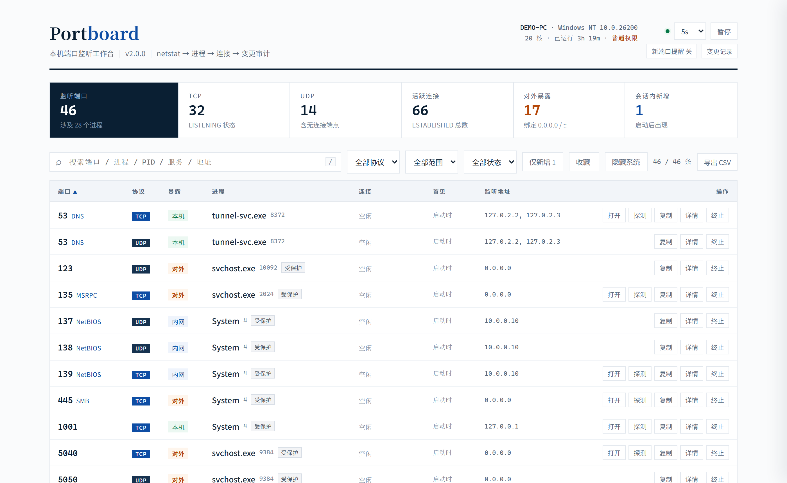
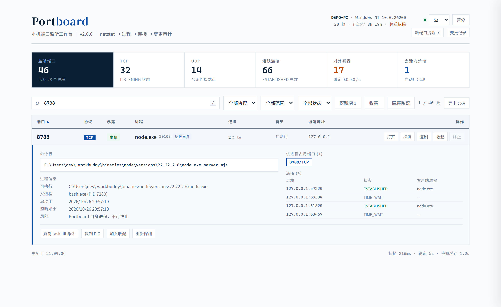
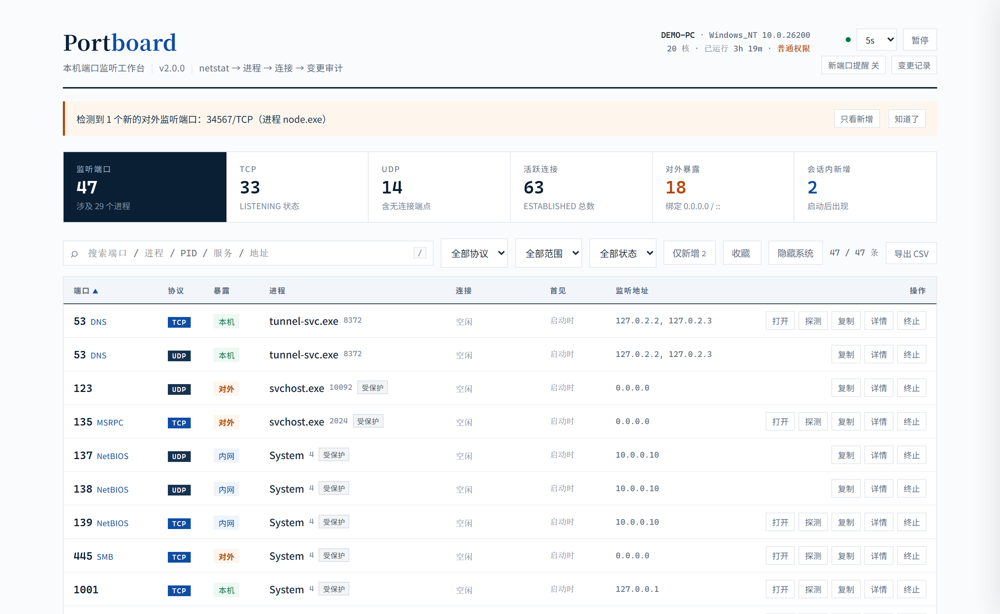
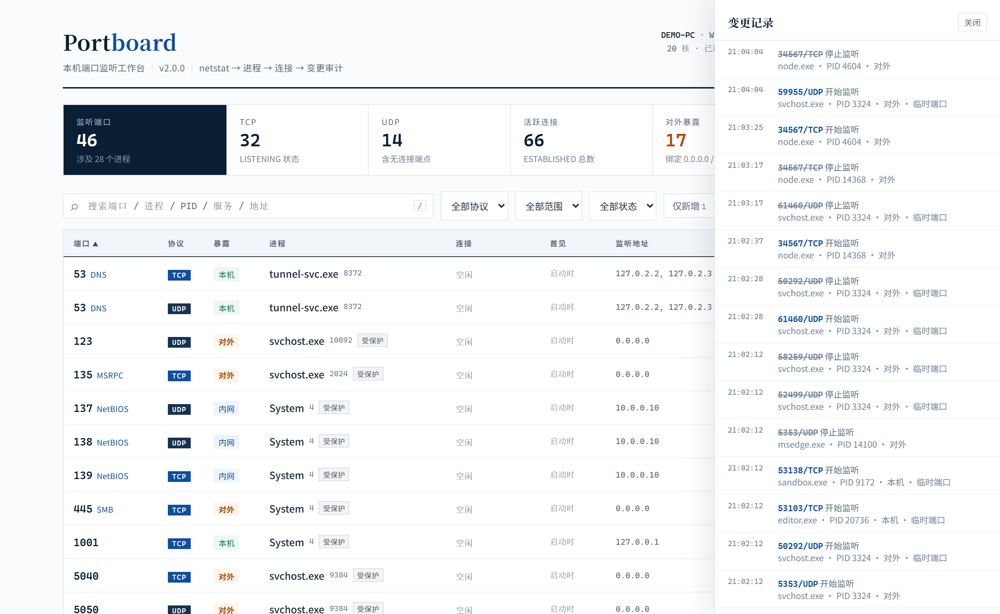

<h1 align="center">Portboard</h1>

<p align="center">
  本机端口监听工作台 · Local port monitoring workbench for Windows
</p>

<p align="center">
  <a href="#zh"><b>简体中文</b></a> &nbsp;·&nbsp; <a href="#en"><b>English</b></a>
</p>

<p align="center">
  <a href="LICENSE"></a>
  = 18">
  
  
</p>

<p align="center">
  
</p>

---

<a id="zh"></a>

## 简体中文

一个跑在本机、只看本机的端口工作台。它回答三个每天都会遇到的问题：

- **这个端口是谁开的？** —— 端口、协议、进程名、PID、可执行路径、命令行、父进程
- **这个端口对外暴露了吗？** —— 区分 `0.0.0.0`/`::`、内网网卡、`127.0.0.1` 三级暴露面
- **关掉它会影响什么？** —— 该进程占用的全部端口、当前连接、是否系统关键进程

### 特性

| | |
|---|---|
| **实时端口清单** | TCP/UDP 监听、进程归属、活跃连接数、TIME_WAIT 数 |
| **暴露面分级** | 对外（`0.0.0.0`/`::`）/ 内网 / 仅本机，暴露口单独计数并高亮 |
| **连接明细** | 对端地址、状态，以及**客户端进程名**（谁在连我） |
| **变更追踪** | 新端口出现即告警（含桌面通知），关闭事件留痕，时间线可回溯 |
| **端口探活** | TCP 握手计时 + HTTP 状态/Server 头/页面标题，判断端口背后是什么服务 |
| **安全终止** | 风险分级 → 影响面提示 → 归属校验 → 优雅退出优先，最后才强杀 |
| **零依赖** | 只用 Node 内置模块，没有 `node_modules`，没有编译步骤 |
| **本地优先** | 只监听 `127.0.0.1`，写操作需要一次性令牌，拒绝任意来源调用 |

### 截图

<p align="center">
  
  
</p>

<p align="center">
  
</p>

### 快速开始

需要 Node.js 18 或更高版本，无需安装任何依赖。

```bat
:: Windows：双击即可，会自动打开浏览器
start-dev.bat
```

```bash
# 或者手动启动
npm start
# 等价于
node server.mjs
```

打开 <http://127.0.0.1:8788>。

### 工作原理

Windows 上读取端口归属有两条路：系统 API（`GetExtendedTcpTable`）或解析命令行工具。本项目选择后者，因为它是唯一「零依赖、不需要编译、不改动用户环境」的方案。代价必须靠调度策略补偿——本机实测（20 核 / 约 140 条连接）：

| 命令 | 平均耗时 | 使用策略 |
|---|---|---|
| `netstat -ano -p TCP` | ~99 ms | 快照 1.2s TTL + 单飞合并并发 |
| `netstat -ano -p UDP` | ~95 ms | 同上 |
| `tasklist /fo csv` | ~355 ms | 进程名表 20s TTL，仅出现未知 PID 时刷新 |
| `Get-CimInstance Win32_Process` | ~534 ms | 可执行路径，后台惰性补全，120s 一次 |
| `Get-NetTCPConnection`（PowerShell） | ~1342 ms | 不用于轮询 |

<details>
<summary><b>设计取舍与已知边界</b></summary>

**为什么不用 PowerShell 的 `Get-NetTCPConnection`？** 它字段更全（含连接创建时间），但单次 1.3 秒，做 5 秒轮询会占掉四分之一的时间片。可执行路径这种「一次拿到、很少变化」的数据才适合走 CIM，并且放在后台异步补全，不阻塞首屏。

**变更追踪怎么做的？** 首帧发现的端口记为基线（不算新增）。此后每轮快照做集合比对：新出现的端口产生 `open` 事件，消失超过 4 秒（宽限期，避免刷新抖动）产生 `close` 事件。事件写入 `.portboard/events.jsonl`，重启后回放最近 300 条。

**为什么 UDP 动态端口不告警？** Windows 的 49152–65535 区间会被系统服务频繁开关，全部告警等于没有告警。这类端口仍记录进审计时间线，但标记为「临时端口」，不触发桌面通知。

**仍然做不到的：**

- 非管理员运行时，跨会话进程的可执行路径与命令行会拿不到（界面会标注「不可获取」，而不是静默失败）
- `netstat` 不提供连接创建时间与流量字节，因此「这条连接挂了多久」「跑了多少数据」无法展示
- 5 秒轮询必然漏掉秒开秒关的瞬时连接，需要 ETW 订阅或 eBPF 才能覆盖
- 不做代码签名校验，也不联动 Windows 防火墙

</details>

### API

| 方法 | 路径 | 说明 |
|---|---|---|
| `GET` | `/api/ports` | 端口快照：`summary` 与 `ports[]`（含 `scope`、`risk`、`states`、`conns`、`firstSeen`、`isNew`、`clients`） |
| `GET` | `/api/system` | 主机名、系统版本、核数、运行时长、是否管理员 |
| `GET` | `/api/events?limit=80` | 变更事件流（倒序） |
| `GET` | `/api/probe?port=3000&proto=TCP` | TCP 握手 + HTTP banner 探活 |
| `GET` | `/api/process/:pid` | 命令行、可执行路径、父进程、启动时间、线程数 |
| `POST` | `/api/kill` | `{ pid, port?, proto?, force? }`，需携带 `X-Portboard-Token` |
| `GET` | `/api/export` | 导出 CSV（带 BOM，Excel 打开中文不乱码） |

### 配置

| 环境变量 | 默认值 | 说明 |
|---|---|---|
| `PORTBOARD_PORT` | `8788` | 监听端口（始终只绑定 `127.0.0.1`） |
| `PORTBOARD_TTL` | `1200` | 端口快照缓存毫秒数，范围 300–30000 |

运行时产物：`.portboard/events.jsonl`（变更审计，可随时删除，已在 `.gitignore` 中）。

### 安全模型

本地 Web UI 的常见风险是「任意网页都能调你的本地接口」。本项目的处理：

- 仅绑定回环地址，并校验来源地址
- 校验 `Host` 头（防 DNS 重绑定）与 `Origin` 头
- 启动时生成一次性令牌注入页面，所有写操作必须携带 `X-Portboard-Token`
- 终止前校验端口归属，防止 PID 复用导致杀错进程
- `PID 0/4`、`svchost`、`lsass` 等系统关键进程默认拒绝终止，需显式二次确认

### 目录结构

```
portboard/
├─ server.mjs            # HTTP 服务 + 采集 + 变更追踪 + 终止逻辑
├─ public/
│  └─ index.html         # 单页前端（原生 JS，无构建）
├─ screenshots/          # 文档截图
├─ start-dev.bat         # Windows 一键启动
├─ package.json
├─ LICENSE
└─ README.md
```

### 许可证

[MIT](LICENSE) © [skywalkerqqq](https://github.com/skywalkerqqq)

<p align="right"><a href="#portboard">↑ 返回顶部 / Back to top</a></p>

---

<a id="en"></a>

## English

A local-only port workbench that answers three questions you hit every day:

- **Who is holding this port?** — port, protocol, process name, PID, executable path, command line, parent process
- **Is it exposed?** — three-level exposure classification: `0.0.0.0`/`::`, LAN interface, or loopback only
- **What breaks if I kill it?** — every port that process owns, live connections, and whether it is a critical system process

### Features

| | |
|---|---|
| **Live port list** | TCP/UDP listeners, owning process, active connections, TIME_WAIT count |
| **Exposure grading** | Internet-facing (`0.0.0.0`/`::`) / LAN / loopback, with exposed ports counted and highlighted |
| **Connection details** | Remote address, state, and the **client process name** — who is actually talking to your port |
| **Change tracking** | Alerts the moment a new port appears (with desktop notifications), records close events, keeps an audit timeline |
| **Port probing** | TCP handshake timing plus HTTP status / `Server` header / page title, so you know what is behind the port |
| **Safe termination** | Risk grading → impact preview → ownership re-check → graceful shutdown first, force kill only as a last resort |
| **Zero dependencies** | Node built-ins only. No `node_modules`, no build step |
| **Local-first** | Binds `127.0.0.1` only; mutating calls require a per-session token |

### Screenshots

<p align="center">
  
  
</p>

<p align="center">
  
</p>

### Quick start

Requires Node.js 18 or newer. No dependencies to install.

```bat
:: Windows: double-click, the browser opens automatically
start-dev.bat
```

```bash
# or start it manually
npm start
# same as
node server.mjs
```

Then open <http://127.0.0.1:8788>.

### How it works

On Windows you can read port ownership either through a system API (`GetExtendedTcpTable`) or by parsing command-line tools. This project takes the second path because it is the only one that stays zero-dependency, needs no compiler, and touches nothing in your environment. The cost is paid back in scheduling — measured on this machine (20 cores, ~140 connections):

| Command | Average | Strategy |
|---|---|---|
| `netstat -ano -p TCP` | ~99 ms | 1.2 s snapshot TTL + single-flight de-duplication |
| `netstat -ano -p UDP` | ~95 ms | same |
| `tasklist /fo csv` | ~355 ms | process-name table with a 20 s TTL, refreshed only on unknown PIDs |
| `Get-CimInstance Win32_Process` | ~534 ms | executable paths, lazily enriched in the background every 120 s |
| `Get-NetTCPConnection` (PowerShell) | ~1342 ms | not used for polling |

<details>
<summary><b>Trade-offs and known limits</b></summary>

**Why not `Get-NetTCPConnection`?** It returns richer data (including connection creation time) but takes ~1.3 s per call — a quarter of every 5-second poll. Expensive, rarely-changing data such as executable paths is instead fetched through CIM in the background, so it never blocks the first paint.

**How is change tracking implemented?** Ports seen in the first snapshot become the baseline. Every later snapshot is diffed against it: a newly appeared port emits an `open` event; a port missing for more than 4 seconds (a grace period to absorb refresh jitter) emits `close`. Events are appended to `.portboard/events.jsonl` and the last 300 are replayed on restart.

**Why are dynamic UDP ports excluded from alerts?** Windows churns through ports 49152–65535 constantly, so alerting on all of them means alerting on nothing. They are still recorded in the audit trail and flagged as ephemeral, but never raise a notification.

**What it still cannot do:**

- Without administrator rights, executable paths and command lines of cross-session processes are unavailable (the UI says so explicitly instead of failing silently)
- `netstat` exposes neither connection creation time nor byte counters, so "how long has this connection been up" is not available
- A 5-second poll will always miss connections that open and close in between; that requires ETW subscriptions or eBPF
- No code-signature verification and no Windows Firewall integration

</details>

### API

| Method | Endpoint | Description |
|---|---|---|
| `GET` | `/api/ports` | Port snapshot: `summary` plus `ports[]` (with `scope`, `risk`, `states`, `conns`, `firstSeen`, `isNew`, `clients`) |
| `GET` | `/api/system` | Hostname, OS, CPU count, uptime, elevation status |
| `GET` | `/api/events?limit=80` | Change events, newest first |
| `GET` | `/api/probe?port=3000&proto=TCP` | TCP handshake + HTTP banner probe |
| `GET` | `/api/process/:pid` | Command line, executable path, parent process, start time, thread count |
| `POST` | `/api/kill` | `{ pid, port?, proto?, force? }` with `X-Portboard-Token` |
| `GET` | `/api/export` | CSV export (UTF-8 BOM so Excel renders Chinese correctly) |

### Configuration

| Variable | Default | Description |
|---|---|---|
| `PORTBOARD_PORT` | `8788` | Listening port (always bound to `127.0.0.1`) |
| `PORTBOARD_TTL` | `1200` | Snapshot cache in milliseconds, 300–30000 |

Runtime artifact: `.portboard/events.jsonl` (the change audit log — safe to delete, already gitignored).

### Security model

The usual risk with a local web UI is that any page in your browser can call your local API. This project addresses it by:

- binding to loopback only and validating the peer address
- validating the `Host` header (DNS-rebinding protection) and the `Origin` header
- generating a per-session token at startup and requiring `X-Portboard-Token` on every mutating request
- re-checking port ownership before termination, so PID reuse cannot make you kill the wrong process
- refusing to terminate `PID 0/4`, `svchost`, `lsass` and other critical processes without an explicit second confirmation

### Project layout

```
portboard/
├─ server.mjs            # HTTP server, collection, change tracking, termination
├─ public/
│  └─ index.html         # single-page frontend (vanilla JS, no build)
├─ screenshots/          # documentation screenshots
├─ start-dev.bat         # one-click launcher for Windows
├─ package.json
├─ LICENSE
└─ README.md
```

### License

[MIT](LICENSE) © [skywalkerqqq](https://github.com/skywalkerqqq)

<p align="right"><a href="#portboard">↑ Back to top / 返回顶部</a></p>
